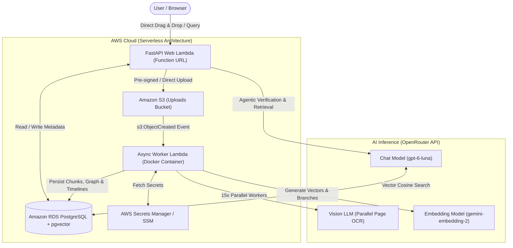
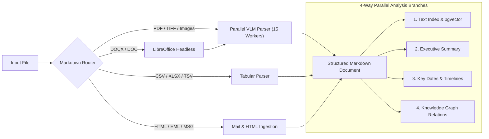

# Agentic RAG: High-Performance Multimodal Document Intelligence Platform

[](https://www.python.org/)
[](https://fastapi.tiangolo.com/)
[](https://aws.amazon.com/)
[](https://github.com/pgvector/pgvector)
[](https://www.docker.com/)
[](https://ecoydsx27jlar5qcljjtlbulbq0pgpwa.lambda-url.ap-south-1.on.aws/)
[](LICENSE)

An enterprise-grade, serverless **Agentic Retrieval-Augmented Generation (RAG)** platform capable of ingesting diverse, complex document formats (PDFs, DOCX, CSV, Excel, Images, TIFF, HTML, and Emails), extracting dense structural information with ultra-fast parallel Vision-Language Models (VLMs), and enabling self-verifying, evidence-backed conversational intelligence.

---

## 🌟 Key Highlights & Innovations

- **Zero-Friction Visitor Experience**: Instant document upload with auto-provisioned private session workspaces—no signup or workspace configuration hurdles.
- **Multimodal Universal Ingestion Router**: Automatically parses and converts incoming documents across formats:
  - **PDF & Multi-page TIFF/Images**: Concurrently processed page-by-page via high-throughput VLM parallel pipelines (**15 concurrent workers**).
  - **DOCX / DOC**: Headless LibreOffice conversion to vector PDF followed by parallel visual parsing.
  - **Excel & CSV (`.xlsx`, `.xls`, `.csv`, `.tsv`)**: Dense markdown tabular preservation.
  - **Emails (`.eml`, `.msg`, `.xml`)**: Email body extraction and automated recursive attachment extraction.
- **Parallel Multi-Branch Document Analysis**:
  - **Semantic Chunker & Vector Index**: Deep embeddings with `google/gemini-embedding-2` stored in PostgreSQL `pgvector` (3072 dimensions).
  - **Executive Summaries**: High-level abstract and key highlights generated automatically.
  - **Key Date & Timeline Extraction**: Temporal events extracted with structured date anchors.
  - **Knowledge Graph**: Entity-relationship extraction mapped into an interactive connection matrix.
- **Agentic Verification Loop**: Queries are processed by an agent that cross-references extracted chunks, enforces source quote verifications, and eliminates hallucinations.
- **100% Serverless & Cloud-Native**: Deployed on AWS Lambda with container images (Amazon ECR), Amazon S3 event-driven triggers, and AWS Aurora PostgreSQL.

---

## 🏗️ System Architecture



---

## 🚀 Ingestion Pipeline Deep Dive



---

## 💻 Tech Stack

| Layer | Technologies |
|---|---|
| **Backend API** | Python 3.12, FastAPI, Uvicorn, Mangum (ASGI adapter) |
| **Agent & AI Framework** | LangChain Core, OpenRouter API |
| **Models** | `openai/gpt-6-luna` (Reasoning & Vision), `google/gemini-embedding-2` (3072-dim embeddings) |
| **Database & Vector Store** | PostgreSQL 16+ with `pgvector` extension, connection pooling |
| **Document Processing** | PyMuPDF (`fitz`), Pillow, LibreOffice headless, Docling |
| **Cloud Infrastructure** | AWS Lambda, Amazon S3, Amazon ECR, AWS Systems Manager, CloudFormation / AWS SAM |
| **Frontend** | Modern Vanilla JavaScript, CSS3 variables, HTML5 drag-and-drop dropzone, SVG icons |

---

## 📂 Project Structure

```text
├── Agent/                         # Agentic reasoning & evidence verification
│   ├── agent.py                   # Main agent execution loop
│   ├── evidence.py                # Quote and source verification
│   ├── tools.py                   # RAG search and retrieval tools
│   └── verify.py                  # Ground truth validation logic
├── Data_Ingestion/                # Multimodal document ingestion engine
│   ├── Markdown_Router.py         # Central ingestion router
│   ├── Image_Markdown/            # Parallel VLM OCR extraction
│   │   └── Parse_Image.py
│   ├── PDF_Markdown/              # PDF & DOCX conversion utilities
│   │   ├── Docx_to_PDF_Conversion.py
│   │   ├── Parse_PDF.py
│   │   └── Pdf_Searchability.py
│   ├── Excel_Markdown/            # Spreadsheets & CSV parsing
│   │   └── Parse_CSV_Excel.py
│   ├── HTML_Markdown/             # Web page extraction
│   │   └── Parse_HTML.py
│   └── Mail_Markdown/             # Email & recursive attachment parsing
│       └── Parse_Mail.py
├── Pipeline/                      # Document processing pipeline
│   ├── branches/                  # Parallel analysis branches
│   │   ├── chunks.py              # Semantic vector indexing
│   │   ├── events.py              # Timeline extraction
│   │   ├── graph.py               # Entity & relation graph extraction
│   │   └── summary.py             # Document summarization
│   ├── chunker.py                 # Markdown-aware text chunking
│   └── process_document.py        # Pipeline orchestrator
├── db/                            # Database interaction & schema
│   ├── database.py                # Connection pool & query layer
│   └── schema.sql                 # PostgreSQL DDL with pgvector indexes
├── worker/                        # AWS Lambda background worker
│   ├── handler.py                 # S3 trigger handler & background warmup
│   ├── warmup.pdf                 # Lightweight container warmup asset
│   └── warmup.py                  # Cold-start container pre-initialization
├── static/                        # Frontend assets
│   ├── app.js                     # Single-page application logic
│   ├── index.html                 # UI layout & direct upload dropzone
│   └── style.css                  # Clean, modern styling
├── main.py                        # FastAPI web application entrypoint
├── template.yaml                  # AWS SAM infrastructure definition
├── samconfig.toml                 # SAM deployment configuration
└── Dockerfile                     # Multi-stage production container build
```

---

## 🛠️ Getting Started Locally

### Prerequisites

- Python 3.12+
- Docker & Docker Compose (or local PostgreSQL with `pgvector`)
- LibreOffice (for local DOCX conversion)
- AWS CLI configured (if testing against AWS resources)

### 1. Clone & Set Up Virtual Environment

```bash
git clone https://github.com/Pankajsh3002/Agentic_RAG.git
cd Agentic_RAG

python3 -m venv .venv
source .venv/bin/activate
pip install -r requirements.txt
```

### 2. Environment Configuration

Create a `.env` file in the project root:

```ini
DB_HOST=localhost
DB_NAME=postgres
DB_USER=postgres
DB_PASS=your_password
DB_PORT=5432

OPENROUTER_API_KEY=your_openrouter_api_key
MAIN_MODEL=openai/gpt-6-luna
EMBED_MODEL=google/gemini-embedding-2
EMBED_DIM=3072

PARSE_WORKERS=15
```

### 3. Initialize Database Schema

```bash
psql -h localhost -U postgres -d postgres -f db/schema.sql
```

### 4. Run the Local Web Server

```bash
uvicorn main:app --host 0.0.0.0 --port 8000 --reload
```

Visit `http://localhost:8000` to interact with the application.

---

## ☁️ Deployment to AWS (Serverless)

The platform is fully automated using **AWS Serverless Application Model (SAM)**:

```bash
# Build Lambda container images
sam build

# Deploy to AWS CloudFormation
sam deploy --no-confirm-changeset
```

### Cloud Resources Created

- **`WebFunction`**: FastAPI application exposed via AWS Lambda Function URL with public CORS.
- **`WorkerFunction`**: 3008 MB memory containerized Lambda with pre-warmed weights for high-speed document processing.
- **`UploadsBucket`**: S3 bucket configured with lifecycle policies and event notifications routing into `WorkerFunction`.
- **`Amazon RDS Aurora PostgreSQL`**: Managed database hosting vector collections and document metadata.

---

## 📖 API Endpoints Overview

| Method | Endpoint | Description |
|---|---|---|
| `GET` | `/` | Serves the web frontend |
| `GET` | `/workspaces` | Lists workspaces (auto-creates default workspace if none exist) |
| `POST` | `/workspaces` | Creates a new named workspace |
| `DELETE` | `/workspaces/{id}` | Deletes workspace and all associated document data |
| `GET` | `/workspaces/{id}/documents` | Lists all documents and their multi-branch status |
| `POST` | `/workspaces/{id}/uploads` | Initiates document upload (local or direct S3 signed upload) |
| `GET` | `/workspaces/{id}/summary` | Fetches executive summaries across documents |
| `GET` | `/workspaces/{id}/timeline` | Retrieves extracted chronologically ordered event dates |
| `GET` | `/workspaces/{id}/graph` | Queries the extracted entity-relationship knowledge graph |
| `POST` | `/workspaces/{id}/ask` | Dispatches an agentic question answering query with citation checks |

---

## 👤 Author

**Pankaj Sharma**
- Role: AI Engineer | GenAI & Agentic Systems
- Location: New Delhi, India
- Email: pankajsharma981105@gmail.com
- [GitHub Profile](https://github.com/Pankajsh3002) &bull; [Agentic RAG Repo](https://github.com/Pankajsh3002/Agentic_RAG)
